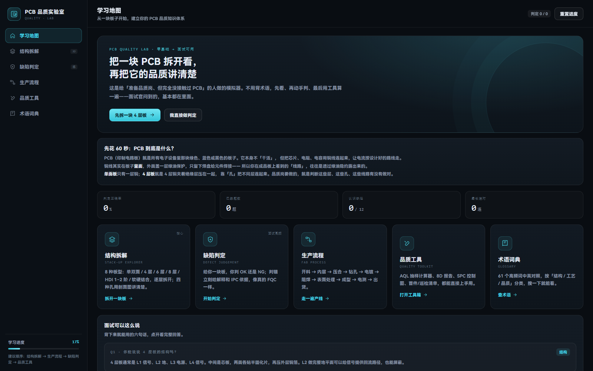
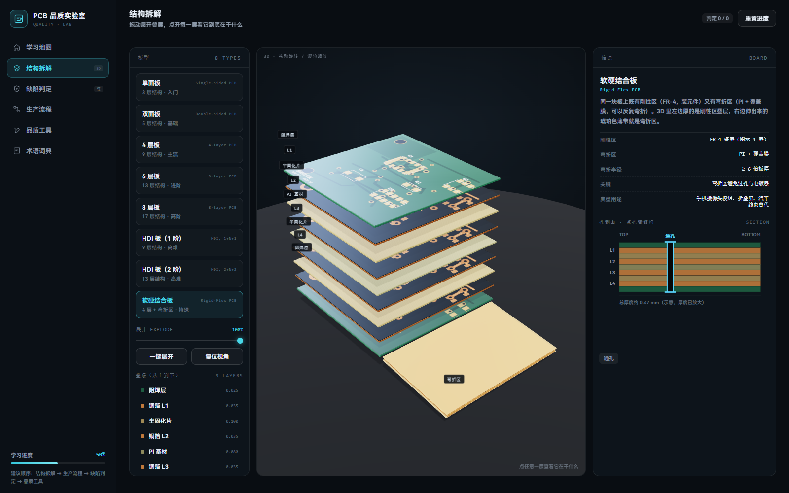
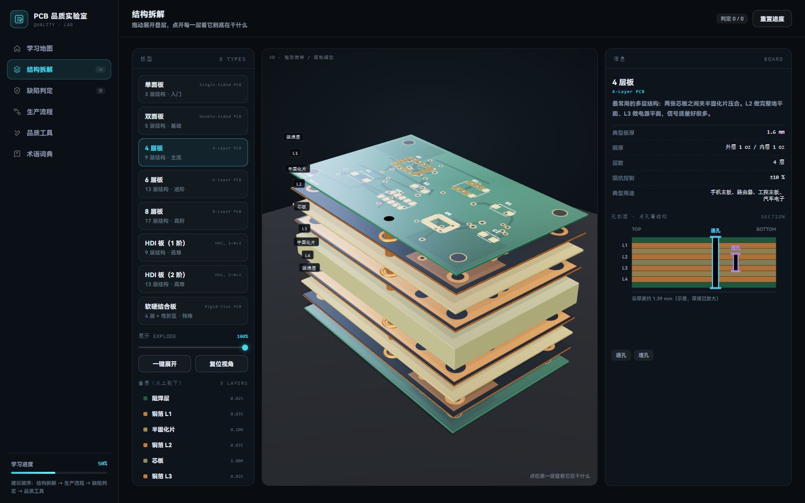
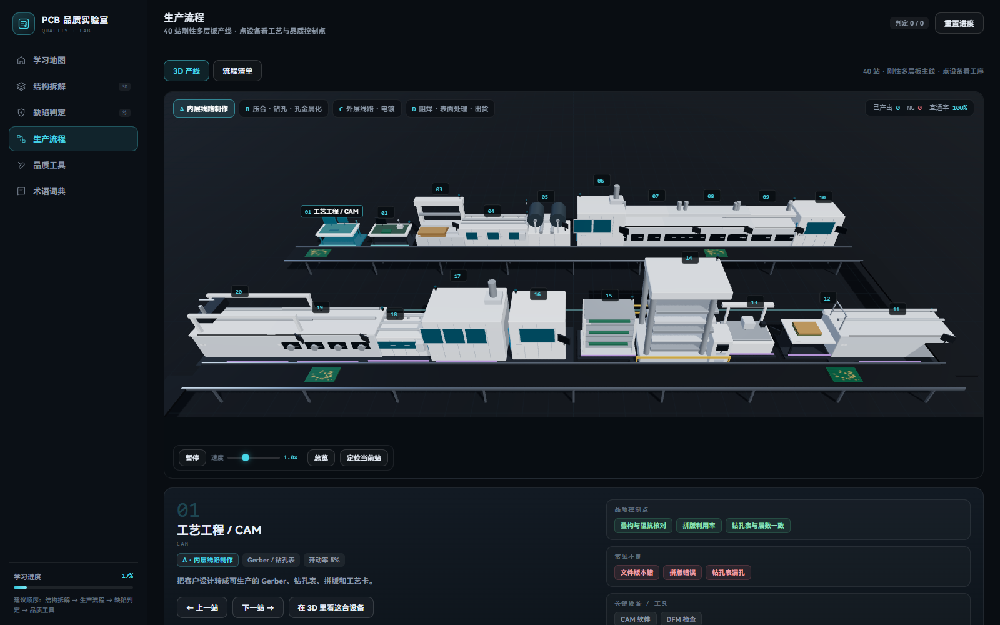

# PCB 品质实验室 · PCB Quality Lab

> 给「PCB 品质岗」新人准备的可交互学习模拟器：**拆开板子看结构、盯着缺陷练判定、跑一遍 40 站产线、用 AQL / 8D / SPC 做工具**。
>
> 纯前端、离线可用，双击 `index.html` 就能打开，不需要装任何东西。

**在线试用**：开启 GitHub Pages 后访问 <https://ryanhu2026.github.io/pcb-quality-lab-3d/>（仓库 Settings → Pages → Branch 选 `main` / root）

---

## 截图

| 学习地图 | 软硬结合板拆解 |
| --- | --- |
|  |  |

| 4 层板实体孔（孔环 + 孔壁随展开拉伸） | 40 站 3D 产线 |
| --- | --- |
|  |  |

---

## 它包含什么

### 1. 结构拆解（8 种板型）
单面板 → 双层板 → 4 层 → 6 层 → 8 层 → HDI（1 阶 / 2 阶）→ 软硬结合板。

- 拖动「展开」滑块，叠层会一层层分开；点任意一层看它的作用
- **实体孔**：通孔 / 盲孔 / 埋孔在每一层有真实的孔环，孔壁会随展开拉伸，通孔穿到底、埋孔只连对应层
- **刚柔结合板**：刚性 FR-4 区 + 真的会弯下去的 PI 弯折带
- 右侧有可点击的孔剖面图，点 L1–L8 也能定位到层

### 2. 缺陷判定
- 12 类常见缺陷图谱（开短路、缺铜、上焊盘、分层、划伤、金面发黑、孔无铜、丝印偏移、板翘…）
- 判定训练：先看板再选结论，答错进**错题本**
- AOI 限时挑战：60 秒内找齐缺陷，记录成绩、最高连击
- 选错会告诉你「为什么错」以及这道缺陷在产线上通常由哪一站造成

### 3. 生产流程（40 站 3D 产线）
按刚性多层板主线拆成 40 站，四段蛇形布局：

- **A 内层线路 01–10** → **B 压合/钻孔/孔金属化 11–20** → **C 外层线路/电镀 21–30** → **D 阻焊/表面处理/出货 31–40**
- 设备逐站建模：开料剪板机、刷磨线、贴膜机、LDI、DES 长线、AOI / X-Ray、棕化线、叠层台、铆合机、真空压合机、CNC 钻孔、去钻污、沉铜线、VCP、图形电镀、阻焊涂布、固化炉、字符喷印、ENIG 线、CNC 铣边、飞针测试…
- 工件沿传送带逐站流动，到站停留时对应设备动作
- **AOI / 电测 / FQC 判 NG** → 不良板变红、被移到线边隔离区，右上角实时显示 产出 / NG / 直通率
- 点设备看这道工序的目的、输出、品质控制点、常见不良、关键工具、开动率；点板子看它的批次、当前站、流程进度

### 4. 品质工具
- **AQL 抽样**（ISO 2859-1 一般检验水平 II）：算样本量、Ac/Re、判定
- **8D 报告**：D1–D8 表单，本地保存、导出 txt
- **SPC 控制图**：X-bar / R 图，自动算 UCL/LCL 并标出越界点
- **FAI / IPQC 检查清单**：可勾选、可保存

### 5. 术语词典
61 条中英对照，按「结构 / 工艺 / 品质」分类，支持搜索。

---

## 快速开始

**只想看效果**：直接打开 `index.html`（或双击 `PCB品质实验室.html`），离线可用。

**改代码**：

```bash
npm install          # 或 pnpm install
npm run build        # 打包并内联成单文件 index.html
npm run test         # jsdom 冒烟测试：5 个视图 + 交互
npm run preview      # 用 @napi-rs/canvas 生成板面贴图预览
```

> 构建产物是**完全自包含的单文件 HTML**：three.js、CSS、贴图全部内联，所以可以直接双击打开、也可以直接丢到 GitHub Pages / 内网共享。

---

## 目录结构

```
src/
  main.js              应用外壳、路由、侧边栏、首页
  data.js              板型 / 孔型 / 缺陷 / 术语 / 面试话术
  data/line40.js       40 站产线数据（工序、输出、品质点、不良）
  lib/
    pcbArt.js          程序化画板面（阻焊、走线、焊盘、丝印）
    aoiArt.js          AOI 缺陷绘制 + 缺陷位置标记
    pcbViewer.js       叠层 3D 查看器（孔环 / 孔壁 / 弯折带）
    factory3d.js       40 站 3D 产线（布局、工件流动、NG 分流）
    machines.js        逐站设备模型（16 类机型 + 每站参数差异）
  views/               6 个页面
scripts/
  dom-test.mjs         jsdom 冒烟测试
  preview-art.mjs      贴图预览导出
preview/               截图
```

## 技术栈

- **three.js r186**：叠层 / 产线两套 3D 场景，OrbitControls + CSS2DRenderer
- **Canvas 2D**：所有 PCB 板面图案都是程序化绘制（不依赖图片素材）
- **esbuild**：打包后由 `inline.mjs` 直接内联成一个 HTML
- **jsdom**：无浏览器冒烟测试

## 说明

- 这是**学习模拟器**，不是任何一家工厂的受控 SOP。工序顺序按公开工艺资料整理，实际产线会按板型、叠构、客户规格调整。
- 3D 设备是「形态级」还原（按设备类型建特征件），不是某个品牌型号的工程图。
- 软硬结合板的弯折半径、孔尺寸等为教学目的做了放大，和真实比例不完全一致。
- `preview/` 里的截图由本项目渲染生成。设备参考素材来自公开资料，仅用于建模学习，**未随仓库分发**。

## License

[MIT](LICENSE) © 2026 RyanHu2026

可以自由使用、修改、商用，保留版权声明即可。
